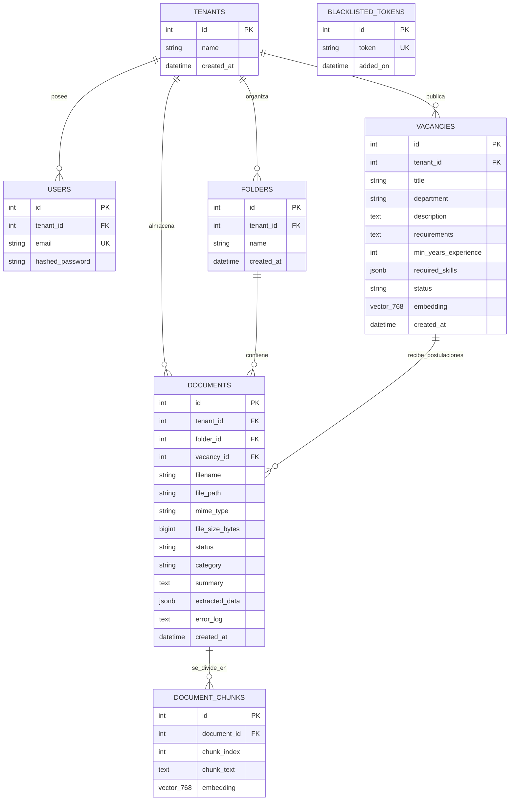
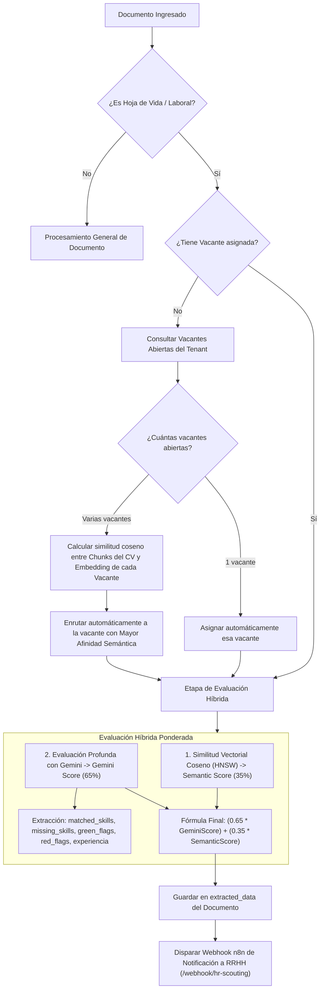
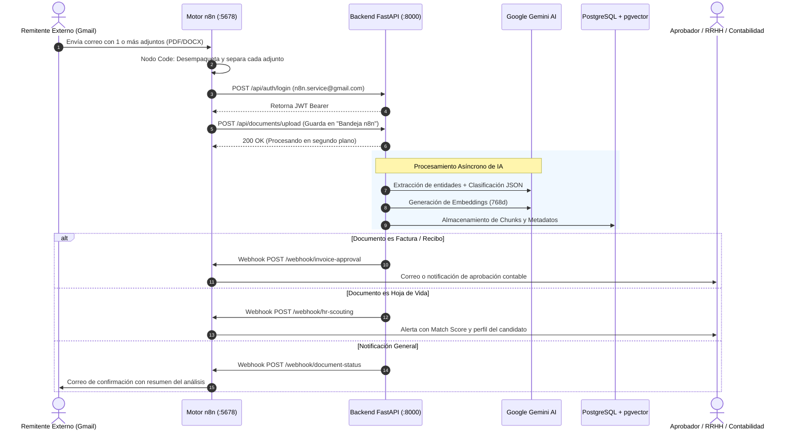
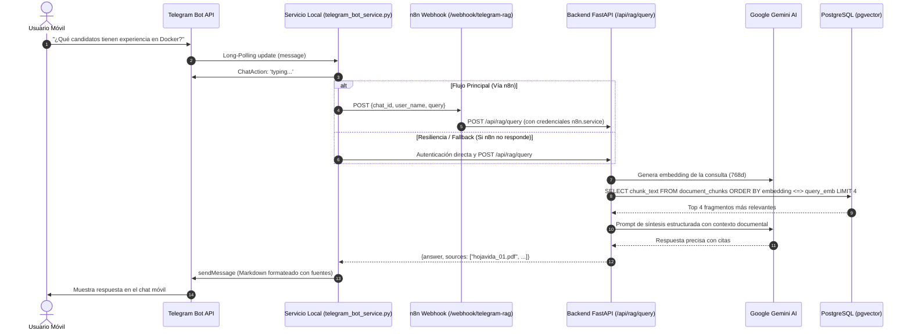

# Documento Maestro de Arquitectura y Diseño de Software (Versión 2.0)
**Proyecto:** Indicio Enterprise (DocuMind)  
**Autor:** Juan Esteban Rojas Meléndez  
**Institución:** Unidades Tecnológicas de Santander (UTS)  
**Fecha de Actualización:** Octubre 2026  
**Estado:** Vigente / Actualizado con Nuevas Capacidades Operativas  

---

## 1. Identificación, Propósito y Evolución del Sistema

### 1.1 Contexto General
**Indicio Enterprise** (originalmente concebido como *DocuMind Enterprise*) es una plataforma empresarial orientada a la **gestión documental inteligente, automatización de flujos de trabajo (Workflow Automation) y análisis semántico profundo** mediante Modelos de Lenguaje Grande (LLMs) y Bases de Datos Vectoriales.

### 1.2 Alcance Original vs. Alcance Actual (Versión 2.0)
En la fase de diseño inicial (Fase 02), el sistema fue modelado como una solución cliente-servidor estándar para la carga de archivos (facturas, contratos), extracción de texto plano y consultas RAG elementales a través de una aplicación web de página única (SPA).

A partir de las nuevas necesidades operativas y funcionales, la arquitectura ha evolucionado sustancialmente incorporando:
1. **Arquitectura Multi-Inquilino (Multi-Tenancy):** Segregación lógica de datos y particionado físico de almacenamiento por empresa u organización (`tenant_id`).
2. **Módulo de Talento Humano y Headhunting Inteligente:** Creación y gestión de vacantes laborales, vectorización semántica de perfiles y algoritmo de **Emparejamiento Híbrido Multivacante (Nivel 3)** para hojas de vida (CVs).
3. **Automatización Integral con n8n:** Orquestación bidireccional mediante triggers de correo (Gmail OAuth2), procesamiento dinámico de adjuntos y webhooks salientes asíncronos para notificaciones contables y de recursos humanos.
4. **Canal Conversacional Móvil (Telegram RAG Bot):** Microservicio conversacional resiliente (`@Indicion8n_bot`) para consulta RAG en lenguaje natural desde dispositivos móviles con citas a las fuentes documentales.
5. **Estructura de Almacenamiento Jerárquico:** Organización de documentos por carpetas virtuales (incluyendo la bandeja de entrada automatizada `Bandeja n8n`).
6. **Mecanismos de Revocación de Sesión:** Lista negra de tokens JWT (`blacklisted_tokens`) para garantizar el cierre seguro de sesión.

---

## 2. Topología y Arquitectura General del Sistema

El sistema implementa una arquitectura desacoplada basada en microservicios y contenedores, coordinada a través de APIs REST, webhooks de eventos y conexiones seguras TLS 1.3 con proveedores de IA.

### 2.1 Diagrama de Arquitectura de la Solución (Mermaid)

```mermaid
graph TB
    subgraph Canales_de_Acceso ["Canales de Usuario & Entrada"]
        WebUser["Usuario Web (Navegador)"]
        MobileUser["Usuario Móvil (Telegram)"]
        EmailUser["Remitente Externo (Correo Gmail)"]
    end

    subgraph Capa_Presentacion ["Capa de Presentación & Orquestación Externa"]
        FrontendSPA["Frontend SPA (React 18 + Vite + TailwindCSS)"]
        TelegramBot["Telegram Bot Service (@Indicion8n_bot / Polling + Fallback)"]
        n8nEngine["Motor de Automatización n8n (Docker :5678)"]
    end

    subgraph Capa_Logica_Backend ["Capa de Lógica de Negocio (Backend FastAPI :8000)"]
        AuthModule["Módulo de Autenticación & JWT Blacklist"]
        DocManager["Gestor Documental & Extracción (pdfplumber, docx)"]
        FolderManager["Gestor de Carpetas & Multi-Tenant"]
        VacanciesModule["Motor de Vacantes & Matchmaking Híbrido"]
        RAGModule["Motor de Consulta Semántica RAG"]
        NotificationModule["Dispatcher de Webhooks Asíncronos"]
    end

    subgraph Capa_Datos_Almacenamiento ["Capa de Persistencia & Almacenamiento"]
        PostgresDB[(PostgreSQL 16 + pgvector :5432)]
        LocalStorage["Almacenamiento Físico (/storage/tenant_{id}/)"]
    end

    subgraph Servicios_Externos_IA ["Servicios Externos de Inteligencia Artificial"]
        GeminiFlash["Google Gemini (gemini-2.0-flash / gemini-3.8-flash)"]
        GeminiEmbeddings["Google Embeddings (text-embedding-005 / 768 dims)"]
    end

    %% Relaciones de Canales
    WebUser -->|HTTPS / REST API| FrontendSPA
    MobileUser -->|Mensajes / Consultas| TelegramBot
    EmailUser -->|Envío de documentos adjuntos| n8nEngine

    %% Relaciones de Frontend y n8n con Backend
    FrontendSPA -->|Bearer JWT / API REST| Capa_Logica_Backend
    TelegramBot -->|Webhook HTTP /api/rag/query| n8nEngine
    TelegramBot -.->|Fallback directo si n8n no responde| RAGModule
    n8nEngine -->|POST /api/documents/upload (User n8n.service)| DocManager
    NotificationModule -->|Webhooks HTTP Document/Invoice/HR Status| n8nEngine

    %% Lógica Interna Backend
    DocManager -->|Guarda binarios validados| LocalStorage
    DocManager -->|Petición de Embeddings Chunks| GeminiEmbeddings
    DocManager -->|Extracción JSON y Clasificación| GeminiFlash
    VacanciesModule -->|Petición de Embedding Vacante| GeminiEmbeddings
    VacanciesModule -->|Evaluación Comparativa LLM 65%| GeminiFlash
    RAGModule -->|Embedding de Pregunta| GeminiEmbeddings
    RAGModule -->|Búsqueda Vectorial Coseno HNSW| PostgresDB
    RAGModule -->|Síntesis de Respuesta con Contexto| GeminiFlash

    %% Persistencia
    Capa_Logica_Backend -->|SQLAlchemy ORM| PostgresDB
```

---

## 3. Modelo de Datos Entidad-Relación y Diccionario de Datos

La base de datos utiliza **PostgreSQL 16** con la extensión `pgvector` activada para soporte de búsquedas de vecinos más cercanos (*Approximate Nearest Neighbor - ANN*) mediante índices **HNSW** (`vector_cosine_ops`).

### 3.1 Diagrama Entidad-Relación (Mermaid)



### 3.2 Diccionario de Datos Detallado

#### Tabla `tenants` (Inquilinos / Empresas)
*Propósito:* Garantiza el aislamiento multi-inquilino de la información.
- `id` (SERIAL, PK): Identificador único del inquilino.
- `name` (VARCHAR(255), NOT NULL): Razón social o nombre de la organización.
- `created_at` (TIMESTAMPTZ): Marca de tiempo de registro.

#### Tabla `users` (Usuarios y Cuentas de Servicio)
*Propósito:* Gestión de credenciales y roles para operadores humanos y servicios automatizados (como `n8n.service@gmail.com`).
- `id` (SERIAL, PK): Identificador único.
- `tenant_id` (INTEGER, FK -> `tenants.id`, ON DELETE CASCADE): Organización a la que pertenece.
- `email` (VARCHAR(255), UNIQUE, NOT NULL): Correo electrónico de inicio de sesión.
- `hashed_password` (VARCHAR(255), NOT NULL): Hash Bcrypt de la clave.

#### Tabla `blacklisted_tokens` (Tokens Revocados)
*Propósito:* Invalidación inmediata de JSON Web Tokens al ejecutar cierre de sesión.
- `id` (SERIAL, PK): Identificador secuencial.
- `token` (VARCHAR(500), UNIQUE, NOT NULL): Firma o token JWT invalidado.
- `added_on` (TIMESTAMPTZ): Fecha y hora de revocación.

#### Tabla `folders` (Carpetas Jerárquicas)
*Propósito:* Agrupación lógica de documentos por departamentos o bandejas automáticas (ej. "Bandeja n8n", "Contabilidad", "RRHH").
- `id` (SERIAL, PK): Identificador de carpeta.
- `tenant_id` (INTEGER, FK -> `tenants.id`, ON DELETE CASCADE): Inquilino propietario.
- `name` (VARCHAR(255), NOT NULL): Nombre de la carpeta.
- `created_at` (TIMESTAMPTZ): Fecha de creación.

#### Tabla `vacancies` (Ofertas de Empleo y Perfiles de Búsqueda)
*Propósito:* Definición de vacantes para el proceso de selección y matchmaking asistido por IA.
- `id` (SERIAL, PK): Identificador único de la vacante.
- `tenant_id` (INTEGER, FK -> `tenants.id`, ON DELETE CASCADE): Inquilino responsable.
- `title` (VARCHAR(255), NOT NULL): Cargo u oferta laboral (ej. "Senior Backend Developer").
- `department` (VARCHAR(100)): Área o departamento solicitante.
- `description` (TEXT, NOT NULL): Descripción general del puesto y responsabilidades.
- `requirements` (TEXT, NOT NULL): Perfil profesional, formación y certificaciones requeridas.
- `min_years_experience` (INTEGER): Años mínimos de experiencia laboral exigidos.
- `required_skills` (JSONB): Lista de competencias técnicas obligatorias (ej. `["Python", "FastAPI", "Docker"]`).
- `status` (VARCHAR(50)): Estado de la vacante (`Abierta`, `Pausada`, `Cerrada`).
- `embedding` (VECTOR(768)): Representación vectorial densa de la vacante, generada a partir del texto consolidado de título, descripción y requisitos.
- `created_at` (TIMESTAMPTZ): Fecha de publicación.
- *Índice:* `ix_vacancies_embedding` utilizando **HNSW** con métrica de distancia coseno (`vector_cosine_ops`), `m=16` y `ef_construction=64`.

#### Tabla `documents` (Expedientes y Documentos Procesados)
*Propósito:* Metadatos principales, estado de auditoría y enlace relacional de cada archivo ingresado.
- `id` (SERIAL, PK): Identificador único del documento.
- `tenant_id` (INTEGER, FK -> `tenants.id`, ON DELETE CASCADE): Inquilino propietario.
- `folder_id` (INTEGER, FK -> `folders.id`, ON DELETE SET NULL): Carpeta donde está archivado.
- `vacancy_id` (INTEGER, FK -> `vacancies.id`, ON DELETE SET NULL): Vacante a la que fue asignado (si es una Hoja de Vida).
- `filename` (VARCHAR(255), NOT NULL): Nombre del archivo original.
- `file_path` (VARCHAR(500), NOT NULL): Ruta en disco (`storage/tenant_{id}/{filename}`).
- `mime_type` (VARCHAR(100), NOT NULL): Tipo MIME validado.
- `file_size_bytes` (BIGINT, NOT NULL): Tamaño en bytes.
- `status` (VARCHAR(50)): `Pendiente`, `Procesado`, `Error`.
- `category` (VARCHAR(50)): Clasificación automática (`Factura / Recibo`, `Contrato / Legal`, `Hoja de Vida / Laboral`, `Informe / Técnico`, `Otro`).
- `summary` (TEXT): Resumen sintético estructurado redactado por Gemini.
- `extracted_data` (JSONB): Datos tabulares estructurados (ej. montos, IVA, fechas, o bien `match_score`, `green_flags`, `red_flags`, `skills_matched`, `resumen_scouting`).
- `error_log` (TEXT): Bitácora de errores si el procesamiento falló.
- `created_at` (TIMESTAMPTZ): Fecha y hora de recepción.

#### Tabla `document_chunks` (Fragmentos e Índices Vectoriales)
*Propósito:* Fragmentación para Retrieval-Augmented Generation (RAG).
- `id` (SERIAL, PK): Identificador del chunk.
- `document_id` (INTEGER, FK -> `documents.id`, ON DELETE CASCADE): Documento padre.
- `chunk_index` (INTEGER): Posición secuencial del fragmento en el documento.
- `chunk_text` (TEXT, NOT NULL): Texto plano del fragmento (~700 caracteres con solapamiento).
- `embedding` (VECTOR(768), NOT NULL): Vector semántico del fragmento.
- *Índice:* `ix_document_chunks_embedding` utilizando **HNSW** (`vector_cosine_ops`, `m=16`, `ef_construction=64`).

---

## 4. Catálogo Completo de Servicios y Endpoints REST

Todas las rutas excepto `/api/auth/login` exigen un encabezado de autorización HTTP `Authorization: Bearer <JWT_TOKEN>`.

### 4.1 Módulo de Seguridad y Autenticación
| Método | Endpoint | Entrada | Salida | Descripción |
| :--- | :--- | :--- | :--- | :--- |
| `POST` | `/api/auth/login` | JSON `{email, password}` | `{access_token, token_type}` | Valida credenciales con hash Bcrypt y expide token JWT. |
| `POST` | `/api/auth/logout` | Header Bearer Token | `{message: "Sesión cerrada exitosamente"}` | Registra el token en `blacklisted_tokens` para evitar reutilización. |

### 4.2 Módulo de Métricas y Analítica
| Método | Endpoint | Parámetros | Salida | Descripción |
| :--- | :--- | :--- | :--- | :--- |
| `GET` | `/api/dashboard/stats` | Ninguno | `{total, processed, errors, categories: {...}}` | Agrega conteos y métricas de procesamiento filtrados por el `tenant_id` del usuario en sesión. |

### 4.3 Módulo de Organización de Carpetas
| Método | Endpoint | Entrada | Salida | Descripción |
| :--- | :--- | :--- | :--- | :--- |
| `POST` | `/api/folders` | JSON `{name: string}` | Objeto `Folder` | Crea una nueva carpeta virtual para el inquilino. |
| `GET` | `/api/folders` | Ninguno | Lista de `Folder` | Consulta todas las carpetas disponibles en la organización. |
| `DELETE` | `/api/folders/{id}` | Parámetro `id` | `{message: "Carpeta eliminada"}` | Elimina la carpeta y desvincula los documentos asociados (`SET NULL`). |

### 4.4 Módulo de Vacantes y Selección de Talento (Headhunting)
| Método | Endpoint | Entrada / Parámetros | Salida | Descripción |
| :--- | :--- | :--- | :--- | :--- |
| `POST` | `/api/vacancies` | JSON `VacancyCreate` | Objeto `Vacancy` | Registra una nueva vacante, genera su vector de 768 dimensiones y lo guarda en pgvector. |
| `GET` | `/api/vacancies` | Query `status` (opcional) | Lista de vacantes con métricas | Retorna vacantes incluyendo `candidates_count`, `top_score` y `avg_score` calculados en tiempo real. |
| `GET` | `/api/vacancies/{id}` | Parámetro `id` | Objeto `Vacancy` detallado + lista de candidatos postulados | Devuelve los detalles completos de la vacante y el desglose de candidatos asociados con sus scores de afinidad. |
| `PUT` | `/api/vacancies/{id}` | JSON `VacancyUpdate` | Objeto `Vacancy` actualizado | Modifica datos o estado (`Abierta`/`Cerrada`), recalculando el embedding si cambian los requisitos. |
| `DELETE` | `/api/vacancies/{id}` | Parámetro `id` | `{message: "Vacante eliminada"}` | Elimina la vacante y desvincula los documentos postulados. |
| `POST` | `/api/vacancies/{id}/match/{doc_id}` | Parámetros `id`, `doc_id` | Resultado de Matchmaking | Ejecuta el algoritmo de evaluación híbrida (Nivel 3) entre la vacante y la hoja de vida seleccionada. |

### 4.5 Módulo de Gestión Documental y Pipeline de IA
| Método | Endpoint | Entrada / Parámetros | Salida | Descripción |
| :--- | :--- | :--- | :--- | :--- |
| `POST` | `/api/documents/upload` | Multipart/Form-Data (`file`, opcionales: `folder_id`, `vacancy_id`) | `{message, document_id, filename}` | Recibe el archivo, lo ubica en `storage/tenant_{id}/` e inicia la tarea asíncrona de extracción, IA y vectorización. |
| `GET` | `/api/documents` | Query: `folder_id`, `category`, `status` | Lista de documentos | Listado paginado/filtrado de documentos accesibles para el inquilino. |
| `GET` | `/api/documents/{id}` | Parámetro `id` | Objeto `Document` | Retorna los metadatos completos, resumen y `extracted_data` (JSON estructurado). |
| `PATCH` | `/api/documents/{id}` | JSON parcial (ej. `{folder_id, category}`) | Objeto `Document` actualizado | Permite mover documentos entre carpetas o corregir categorías manualmente. |
| `PATCH` | `/api/documents/{id}/workflow-update` | JSON `{status, error_log, extracted_data}` | Objeto `Document` | Endpoint seguro utilizado por n8n para retroalimentar el estado tras aprobaciones o revisiones externas. |
| `DELETE` | `/api/documents/{id}` | Parámetro `id` | `{message: "Documento eliminado"}` | Borra el registro en la BD, elimina en cascada sus chunks vectoriales y remueve el archivo físico en disco. |
| `GET` | `/api/documents/{id}/download` | Parámetro `id` | Stream binario (`FileResponse`) | Descarga directa del archivo original validando control de acceso. |

### 4.6 Módulo RAG (Retrieval-Augmented Generation)
| Método | Endpoint | Entrada | Salida | Descripción |
| :--- | :--- | :--- | :--- | :--- |
| `POST` | `/api/rag/query` | JSON `{"query": string}` | `{"answer": string, "sources": [string]}` | Vectoriza la consulta del usuario, ejecuta búsqueda por similitud de coseno en `document_chunks` y sintetiza una respuesta precisa con citas. |

---

## 5. Diseño del Motor de Reclutamiento y Emparejamiento Híbrido (Nivel 3)

El proceso de emparejamiento de Hojas de Vida con Vacantes no se limita a una simple comparación de palabras clave. Implementa un **modelo híbrido de dos capas**:



### 5.1 Desglose de Ponderación
$$\text{Score Final} = (0.65 \times \text{Score LLM Gemini}) + (0.35 \times \text{Score Semántico Coseno})$$

- **Score Semántico (35%):** Evalúa la cercanía matemática global entre la totalidad de los fragmentos del candidato y el perfil de la vacante, evitando sesgos léxicos.
- **Score Gemini LLM (65%):** Analiza en detalle los requisitos excluyentes (años de experiencia, tecnologías requeridas, certificaciones), detectando discrepancias (*red flags*) o ventajas competitivas destacadas (*green flags*).

---

## 6. Arquitectura de Automatización con n8n y Webhooks

El sistema delega la recepción masiva de documentos y el despacho de alertas a un motor de flujos **n8n** desplegado en Docker, evitando sobrecargar el hilo de FastAPI:



---

## 7. Subsistema Conversacional RAG Multi-Canal (Telegram Bot)

Para permitir a los directivos y auditores consultar información desde cualquier lugar, se diseñó el servicio conversacional de Telegram (`backend/telegram_bot_service.py`):



---

## 8. Seguridad, Aislamiento Multi-Tenant y Almacenamiento

1. **Aislamiento de Archivos en Disco:**
   Los archivos físicos ya no se guardan en un directorio plano único. Cada archivo se almacena siguiendo la convención:
   ```text
   backend/storage/tenant_{tenant_id}/{filename}
   ```
   Esto previene colisiones de nombres entre organizaciones distintas y garantiza que un tenant no pueda acceder por ruta estática a los archivos de otro.

2. **Aislamiento en Base de Datos:**
   Cada consulta (`SELECT`, `UPDATE`, `DELETE`) en `main.py` aplica el filtro mandatorio:
   ```python
   filter(Model.tenant_id == current_user.tenant_id)
   ```
   impidiendo fugas de datos entre entidades.

3. **Revocación de Credenciales:**
   La incorporación de `BlacklistedToken` permite que al pulsar "Cerrar sesión" en el frontend, el token quede formalmente inutilizado en base de datos aunque aún no haya vencido su tiempo de expiración estándar.

4. **Sanitización de Respuestas:**
   El backend valida y limpia montos monetarios internacionales (`$`, `USD`, `COP`, `EUR`), homogeneizando valores numéricos para análisis confiable en los tableros del Dashboard.

---

## 9. Matriz Comparativa: Fase 02 Original vs. Arquitectura Actual (v2.0)

| Dimensión de Diseño | Fase 02 Original (Documento PDF) | Arquitectura Actual v2.0 (Código Activo) |
| :--- | :--- | :--- |
| **Arquitectura de Tenants** | Mono-inquilino (un solo espacio común). | **Multi-tenant estricto** (`tenants`, almacenamiento físico `storage/tenant_{id}/`). |
| **Modelos de Datos** | 3 entidades (`users`, `documents`, `document_chunks`). | **7 entidades** (`tenants`, `users`, `blacklisted_tokens`, `folders`, `vacancies`, `documents`, `document_chunks`). |
| **Módulo de Vacantes / RRHH** | Inexistente. | **Implementado**: Vacantes vectorizadas, matchmaking híbrido (65% LLM + 35% Coseno), enrutamiento multivacante y componente frontend [`Vacancies.jsx`](file:///c:/Users/USUARIO/Documents/DocuMind-Final/frontend/src/components/Vacancies.jsx). |
| **Canales de Consulta** | Exclusivamente interfaz web (SPA). | **Multi-canal**: Interfaz Web + Asistente móvil Telegram (`@Indicion8n_bot`) con fallback resiliente. |
| **Automatización e Ingesta** | Únicamente carga manual por formulario web. | **Automatización n8n**: Ingesta masiva desde Gmail, extracción dinámica de adjuntos y 3 tipos de webhooks de notificación. |
| **Gestión de Carpetas** | Sin organización por directorios. | **Carpetas lógicas** (`folders`) con soporte de carpetas de sistema (ej. `Bandeja n8n`). |
| **Cierre de Sesión** | Olvido del token en cliente (LocalStorage). | **Cierre seguro en servidor** mediante `BlacklistedToken`. |
| **Identidad del Sistema** | *DocuMind Enterprise* | *Indicio Enterprise* (DocuMind). |

---

> [!NOTE]
> Este documento representa la especificación técnica oficial y fidedigna del estado actual de la plataforma, sirviendo como base de ingeniería para futuras actualizaciones de los manuales de usuario ([Fase 06](file:///c:/Users/USUARIO/Documents/DocuMind-Final/documentos/06_Manual_Usuario/Documind%20EnterPrise%20Fase%2006.pdf)) y manuales técnicos de administración ([Fase 07](file:///c:/Users/USUARIO/Documents/DocuMind-Final/documentos/07_Manual_Tecnico/Documind%20EnterPrise%20Fase%2007.pdf)).
