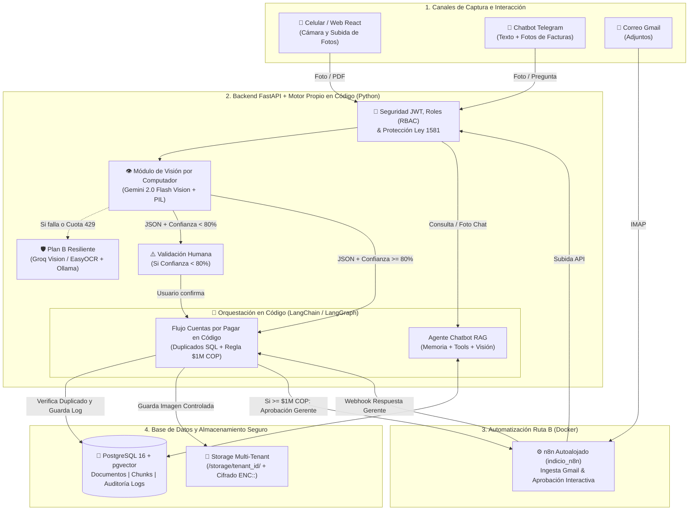

# Entrega Semana 1 – Documento de Diseño y Arquitectura (Tercer Corte)

**Asignatura:** Desarrollo de Aplicaciones Empresariales  
**Programa:** Tecnología en Desarrollo de Sistemas Informáticos  
**Docente:** Wilson Castaño Galviz  
**Proyecto:** Indicio Enterprise (DocuMind) – Plataforma de Gestión Documental Inteligente, Automatización y Visión por Computador  
**Fecha:** Noviembre de 2026  

---

## 1. Inventario de Flujos Actuales en n8n (Especificación Base)

Actualmente, **Indicio Enterprise** cuenta con **5 flujos de automatización** respaldados en [`n8n_workflows/workflows_backup.json`](file:///c:/Users/USUARIO/Documents/DocuMind-Final/n8n_workflows/workflows_backup.json), [`scripts/headhunter_workflow.json`](file:///c:/Users/USUARIO/Documents/DocuMind-Final/scripts/headhunter_workflow.json) y [`scripts/telegram_rag_workflow.json`](file:///c:/Users/USUARIO/Documents/DocuMind-Final/scripts/telegram_rag_workflow.json). A continuación se detalla qué hace cada uno y cómo operará en el Tercer Corte:

| # | Nombre del Flujo | Disparador (Trigger) | Pasos Principales | Servicios Externos | Resultado que Produce | Estrategia en Tercer Corte |
| :-: | :--- | :--- | :--- | :--- | :--- | :--- |
| **1** | **Indicio - Ingesta de Correos** (`QrSwo7UYD5CzOu5H`) | `Gmail Trigger` (revisa cada minuto correos con adjuntos `has:attachment`). | 1. Descarga el adjunto del correo. 2. Hace login en FastAPI (`/api/auth/login`). 3. Sube el archivo a `/api/documents/upload`. | Gmail API (OAuth2), FastAPI Backend. | El archivo queda guardado en la carpeta `Bandeja n8n` y se dispara su análisis con IA. | **Se conserva en n8n Docker** (`indicio_n8n` autoalojado). |
| **2** | **Enrutar y Aprobar Facturas – Cuentas por Pagar** (`bijqPY7H7RHCKIPj`) | `Webhook POST` (`/webhook/invoice-approval`) enviado por FastAPI al procesar una factura. | 1. Verifica en PostgreSQL si la factura está duplicada (`numero_factura` + `emisor_nit`). 2. Si es duplicada, la bloquea. 3. Si es menor a \$1.000.000 COP, la aprueba sola. 4. Si es $\ge$ \$1.000.000 COP, envía correo interactivo (`sendAndWait`) al gerente con botones Aprobar/Rechazar. | PostgreSQL (`indicio_db`), Gmail API, FastAPI (`/workflow-update`). | Mueve la factura a `Facturas Duplicadas`, `Facturas Aprobadas` o `Facturas Rechazadas` y actualiza `estado_contable`. | **Se migra a código Python con LangGraph** (Flujo IA principal en código) + soporte de notificación en n8n Docker. |
| **3** | **Indicio - Telegram RAG Bot** (`TelegramRAG001`) | `Webhook POST` (`/webhook/telegram-rag`) desde el servicio del bot de Telegram. | 1. Autentica el servicio en FastAPI. 2. Envía la pregunta a `/api/rag/query`. 3. Formatea la respuesta con las fuentes documentales citadas. | Telegram Bot API, FastAPI, Google Gemini, PostgreSQL (`pgvector`). | Envía al usuario en Telegram una respuesta precisa basada en los documentos de la empresa. | **Se migra 100% a código Python con LangChain / LangGraph** (con memoria conversacional y uso de herramientas). |
| **4** | **Headhunter Autónomo & Scouting RRHH** (`HRScoutHunter001`) | `Webhook POST` (`/webhook/hr-scouting`) cuando se procesa una Hoja de Vida. | 1. Evalúa si el `match_score` híbrido es $\ge 80\%$. 2. Si es $< 80\%$, lo envía a `Banco de Talentos`. 3. Si es $\ge 80\%$, envía tarjeta de Scouting al gerente con botones de decisión. | Gmail API (OAuth2), FastAPI (`/workflow-update`). | Clasifica al candidato en `Candidatos Seleccionados` o `Banco de Talentos`. | **Se conserva en n8n Docker** y el cálculo de emparejamiento híbrido vive en código Python ([`main.py`](file:///c:/Users/USUARIO/Documents/DocuMind-Final/backend/main.py#L452-L549)). |
| **5** | **Indicio - Notificaciones Generales** (`6dRsY45ewp8ZkMs3`) | `Webhook POST` (`/webhook/document-status`) al finalizar cualquier documento. | 1. Recibe nombre, categoría y estado del archivo. 2. Envía correo de confirmación al usuario. | Gmail API (OAuth2). | Alerta por correo electrónico con el resumen ejecutivo del documento procesado. | **Se conserva en n8n Docker** con registro de auditoría en PostgreSQL. |

---

## 2. Elección de Ruta de Reemplazo (Componente 1)

* **Ruta Elegida:** **Ruta B (n8n Autoalojado en Docker + Flujos de IA en Código Propio con LangChain / LangGraph).**
* **Justificación Técnica:**
  1. **Cero dependencia de n8n Cloud (100% Gratuito):** El contenedor `indicio_n8n` ya corre autoalojado en Docker Compose junto a PostgreSQL (`indicio_db`), sin límite de ejecuciones ni costos de suscripción.
  2. **Cumplimiento estricto de la condición de la Ruta B:** Para no depender de n8n en las tareas críticas de Inteligencia Artificial, **dos flujos completos con IA vivirán 100% en el código de Python (FastAPI)** orquestados con **LangChain y LangGraph**:
     * **Flujo 1 en código (Agente Conversacional RAG con Memoria y Tools):** El chatbot web y de Telegram ejecutará un grafo de **LangGraph** con memoria conversacional por sesión, búsqueda vectorial en `pgvector` y herramientas (`@tool`) para consultar facturas, vacantes y estados contables, además de recibir fotos directamente desde el chat.
     * **Flujo 2 en código (Orquestador de Cuentas por Pagar y Auditoría de Facturas):** Un grafo de estado en **LangGraph** dentro de FastAPI que recibe el JSON del módulo de Visión, valida el nivel de confianza, verifica duplicados en PostgreSQL, aplica la regla de aprobación automática ($< \$1.000.000\text{ COP}$) y registra la auditoría completa en base de datos.
  3. **Plan B ante fallos o cuota agotada:** Si la cuota gratuita de **Google Gemini 2.0 Flash** devuelve error `429`, el orquestador en código conmuta automáticamente a un **Plan B gratuito** (**Groq API** con Llama 3.2 Vision / Llama 3.3 70B o **OCR local con Tesseract/EasyOCR + Ollama**), garantizando continuidad operativa.

---

## 3. Elección del Caso de Uso de Visión por Computador (Componente 2)

* **Caso de Uso Elegido:** **Lectura de Facturas o Recibos (Proceso de Cuentas por Pagar y Control de Gastos).**
* **Qué recibe el módulo:**
  * Fotografías reales tomadas desde la cámara del celular (`.jpg`, `.jpeg`, `.png`, `.webp`) o PDFs escaneados de facturas y recibos físicos/POS.
  * **Canales de captura (3 vías):**
    1. **Interfaz Web / Móvil (`Repository.jsx`):** Subida de imagen o captura directa con cámara del celular (`capture="environment"`).
    2. **Chatbot de Telegram (`@Indicion8n_bot`):** Envío directo de una foto de la factura al chat del bot.
    3. **Ingesta por Correo:** Facturas adjuntas en imagen o PDF escaneado.
* **Cómo procesa la imagen:**
  * Utiliza el modelo multimodal gratuito **Google Gemini 2.0 Flash Vision** (con fallback a OCR local + modelo alternativo en caso de agotamiento de cuota) y anonimización/protección de datos personales conforme a la **Ley 1581 de 2012**.
* **Qué devuelve y qué decisión toma en el negocio:**
  1. **Extracción JSON con Nivel de Confianza:** Extrae `emisor_nombre` (proveedor), `emisor_nit`, `numero_factura`, `fecha_emision`, `fecha_vencimiento`, `items` (lista detallada de productos/servicios con cantidad, valor unitario y subtotal), `monto_impuestos`, `monto_total` y un puntaje `confidence_score` (0% a 100%).
  2. **Revisión Humana si la confianza es baja (`< 80%`):** Si la foto está borrosa o incompleta (`confidence_score < 0.80`), el sistema no aprueba la factura a ciegas; la marca como `"Requiere Revisión"` y muestra en pantalla los campos detectados junto a la foto para que el usuario los valide antes de guardar.
  3. **Disparo automático del proceso contable (`>= 80%`):** Si la confianza es alta, dispara el motor de Cuentas por Pagar: bloquea si está duplicada en PostgreSQL, aprueba sola si es menor a \$1.000.000 COP, o solicita autorización gerencial si supera \$1.000.000 COP.

---

## 4. Arquitectura Propuesta (Tercer Corte)

### Tabla Resumen de Herramientas Gratuitas Seleccionadas

| Necesidad | Herramienta Elegida (Nivel Gratuito / Open Source) |
| :--- | :--- |
| **Modelo Multimodal de Visión** | **Google Gemini 2.0 Flash Vision** (Nivel gratuito de Google AI Studio) |
| **Plan B (Fallback de IA y Visión)** | **Groq Cloud API** (Nivel gratuito Llama Vision/Text) + **EasyOCR / Tesseract** local |
| **Orquestación de IA en Código** | **LangChain** + **LangGraph** (Cadenas, Memoria del Chatbot, Tools y Grafo de Facturas) |
| **Motor de Automatización (Ruta B)** | **FastAPI (Python)** en código propio + **n8n Autoalojado en Docker** (`indicio_n8n`) |
| **Base de Datos y Vectores** | **PostgreSQL 16 + pgvector** en contenedor Docker (`indicio_db`) |
| **Seguridad y Auditoría** | JWT, Roles (`admin`, `auditor`, `user`), Cifrado `Fernet/RSA` en reposo y tabla `workflow_audit_logs` |

