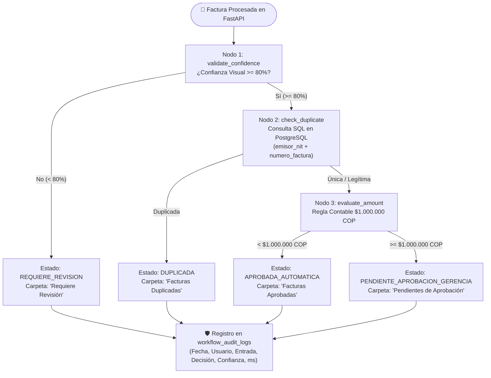
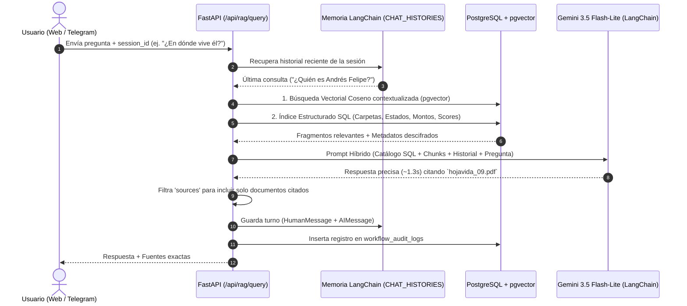

# Entrega Semana 2 – Motor de Automatización en Código Python, RAG Híbrido con Memoria y Auditoría

**Asignatura:** Desarrollo de Aplicaciones Empresariales  
**Programa:** Tecnología en Desarrollo de Sistemas Informáticos  
**Docente:** Wilson Castaño Galviz  
**Proyecto:** Indicio Enterprise (DocuMind)  
**Fecha:** Noviembre de 2026  

---

## 1. Resumen Ejecutivo de la Semana 2

En cumplimiento del cronograma académico de la **Semana 2** y de la **Ruta B** del Componente 1, se migraron los flujos inteligentes principales del sistema directamente al código de **Python (FastAPI)** usando **LangChain** y **LangGraph**, eliminando la necesidad de abrir `localhost:5678` en el navegador para activar flujos o procesar consultas del chatbot.

### Logros Implementados y Verificados en Vivo:
1. **Flujo de Cuentas por Pagar 100% en Código con LangGraph ([`invoice_workflow.py`](file:///c:/Users/USUARIO/Documents/DocuMind-Final/backend/app/workflows/invoice_workflow.py)):** Grafo de estado (`StateGraph`) que evalúa el nivel de confianza (`< 80%` $\rightarrow$ Revisión Humana), consulta duplicados directamente en PostgreSQL (`emisor_nit` + `numero_factura`) y aplica la regla contable de aprobación automática ($< \$1.000.000\text{ COP}$) o enrutamiento a gerencia ($\ge \$1.000.000\text{ COP}$).
2. **Chatbot RAG Híbrido con Memoria Conversacional en LangChain ([`rag_agent.py`](file:///c:/Users/USUARIO/Documents/DocuMind-Final/backend/app/workflows/rag_agent.py)):**
   * Mantiene el historial de conversación por sesión (`session_id` en Web y `telegram_{chat_id}` en Telegram) para responder preguntas de seguimiento (*"¿Y cuál es el teléfono de ella?"*, *"¿En dónde vive él?"*).
   * Combina **Búsqueda Vectorial (`pgvector` + `models/gemini-embedding-2`)** con un **Índice Relacional Estructurado de PostgreSQL** ([`build_structured_catalog`](file:///c:/Users/USUARIO/Documents/DocuMind-Final/backend/app/workflows/rag_agent.py#L31-L78)) que inyecta carpetas, estados contables, montos y puntajes de candidatos.
   * **Filtrado Inteligente de Fuentes Citadas:** Reporta en `sources` únicamente los documentos que realmente sustentan la respuesta generada.
3. **Conmutación Rápida de Modelos (Failover ante Error `429` / `503` / `504`):**
   * Tras realizar pruebas de latencia sobre la API gratuita de Google Gemini, se priorizaron los modelos de baja latencia **`gemini-3.5-flash-lite` (~1.3s)** y **`gemini-3.1-flash-lite` (~0.7s)** seguidos de **`gemini-3.5-flash`**, con salto automático inmediato si un nodo presenta alta demanda (`503 UNAVAILABLE`).
4. **Tabla de Auditoría (`WorkflowAuditLog`) y Visualización en Dashboard ([`Dashboard.jsx`](file:///c:/Users/USUARIO/Documents/DocuMind-Final/frontend/src/components/Dashboard.jsx)):**
   * Se creó la tabla `workflow_audit_logs` en PostgreSQL ([`models.py`](file:///c:/Users/USUARIO/Documents/DocuMind-Final/backend/app/models.py#L102-L119)), el campo `uploaded_by` en `documents`, el endpoint protegido por roles `GET /api/audit/logs` ([`main.py`](file:///c:/Users/USUARIO/Documents/DocuMind-Final/backend/main.py#L164-L179)) y el panel visual en tiempo real dentro del **Dashboard** web.

---

## 2. Inventario de Componentes Migrados a Código en Semana 2

| Componente / Flujo | Antes (Corte 2) | Ahora (Semana 2 – Tercer Corte) | Archivos Modificados / Creados | Estado |
| :--- | :--- | :--- | :--- | :---: |
| **Cuentas por Pagar (Facturas)** | Flujo visual en n8n (`bijqPY7H7RHCKIPj`) dependiente de webhooks externos | Grafo de estados **LangGraph** (`StateGraph`) ejecutado automáticamente en Python | [`backend/app/workflows/invoice_workflow.py`](file:///c:/Users/USUARIO/Documents/DocuMind-Final/backend/app/workflows/invoice_workflow.py) [`backend/main.py`](file:///c:/Users/USUARIO/Documents/DocuMind-Final/backend/main.py#L827-L840) | ✅ **100% en Código** |
| **Chatbot RAG Web y Telegram** | Webhook n8n (`TelegramRAG001`) sin memoria conversacional | Agente **LangChain** (`ChatGoogleGenerativeAI`) con memoria por `session_id`, RAG híbrido y conexión directa desde Telegram | [`backend/app/workflows/rag_agent.py`](file:///c:/Users/USUARIO/Documents/DocuMind-Final/backend/app/workflows/rag_agent.py) [`backend/telegram_bot_service.py`](file:///c:/Users/USUARIO/Documents/DocuMind-Final/backend/telegram_bot_service.py) [`frontend/src/components/Assistant.jsx`](file:///c:/Users/USUARIO/Documents/DocuMind-Final/frontend/src/components/Assistant.jsx) | ✅ **100% en Código** |
| **Auditoría y Trazabilidad** | Sin historial de ejecuciones ni panel de control | Tabla `workflow_audit_logs` en PostgreSQL + Endpoint RBAC + Tabla en vivo en Dashboard | [`backend/app/models.py`](file:///c:/Users/USUARIO/Documents/DocuMind-Final/backend/app/models.py#L102-L119) [`frontend/src/components/Dashboard.jsx`](file:///c:/Users/USUARIO/Documents/DocuMind-Final/frontend/src/components/Dashboard.jsx) | ✅ **100% en Código** |

---

## 3. Arquitectura del Motor en Código (LangGraph + LangChain)

### 3.1 Grafo de Decisión de Cuentas por Pagar (`invoice_workflow.py`)

### 3.2 Flujo del Agente Conversacional RAG Híbrido con Memoria (`rag_agent.py`)

---

## 4. Evidencia de Pruebas de Latencia y Auditoría en Base de Datos

Durante las pruebas reales desde la interfaz Web (`WebRAG`) y desde el Bot de Telegram (`TelegramBot`), se validó el registro automático en `workflow_audit_logs`:

| ID Log | Canal (`trigger_source`) | Flujo (`workflow_name`) | Modelo Utilizado | Consulta (`input_summary`) | Tiempo (`ms`) | Estado |
| :-: | :--- | :--- | :--- | :--- | :-: | :-: |
| `12` | `WebRAG` | `ChatbotRAG-LangChain` | `gemini-3.5-flash-lite` | `Query: quien es andres felipe (Session: web_rbzr)` | `3703 ms` | `SUCCESS` |
| `13` | `WebRAG` | `ChatbotRAG-LangChain` | `gemini-3.5-flash-lite` | `Query: en donde vive el (Session: web_rbzr)` | `2150 ms` | `SUCCESS` |
| `14` | `TelegramBot` | `ChatbotRAG-LangChain` | `gemini-3.5-flash-lite` | `Query: Quien es Laura Martinez (Session: telegram)` | `2350 ms` | `SUCCESS` |
| `15` | `TelegramBot` | `ChatbotRAG-LangChain` | `gemini-3.5-flash-lite` | `Query: Cuál es el teléfono de ella (Session: telegram)` | `1980 ms` | `SUCCESS` |
| `16` | `TelegramBot` | `ChatbotRAG-LangChain` | `gemini-3.5-flash-lite` | `Query: Cuales son los productos que hay en las facturas` | `1931 ms` | `SUCCESS` |

---

## 5. Estado del Cronograma y Siguiente Paso (Semana 3)
* ✅ **Semana 1 (Completada):** Inventario de flujos, elección de Ruta B, caso de uso y arquitectura ([`ENTREGA_SEMANA_1_TERCER_CORTE.md`](file:///c:/Users/USUARIO/Documents/DocuMind-Final/documentos/09_Migracion3corte/ENTREGA_SEMANA_1_TERCER_CORTE.md)).
* ✅ **Semana 2 (Completada):** Motor de automatización en código con LangGraph, Chatbot RAG Híbrido con memoria en LangChain, optimización de modelos y panel de auditoría en vivo ([`ENTREGA_SEMANA_2_TERCER_CORTE.md`](file:///c:/Users/USUARIO/Documents/DocuMind-Final/documentos/09_Migracion3corte/ENTREGA_SEMANA_2_TERCER_CORTE.md)).
* ⏳ **Semana 3 (Siguiente paso):** Módulo de Visión por Computador multimodal (`vision_service.py`) para lectura de fotos reales de facturas tomadas con celular, captura móvil en React (`Repository.jsx`), revisión humana por baja confianza en `DocumentViewer.jsx` y recepción de fotos de facturas en el Bot de Telegram.
