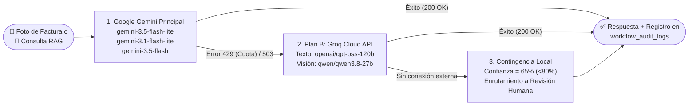

# Entrega Semana 4 – Tercer Corte: Integración Total en Python, Plan B Resiliente (Groq), Seguridad Ley 1581 y Matriz de 20 Pruebas de Visión

**Proyecto:** Indicio Enterprise (DocuMind)  
**Asignatura:** Desarrollo de Aplicaciones Empresariales  
**Docente:** Wilson Castaño Galviz  
**Fecha:** Noviembre de 2026  

---

## 1. Resumen Ejecutivo de la Semana 4

En cumplimiento del cronograma de la **Semana 4** de la guía académica, se consolidó la calidad transversal de la plataforma **Indicio Enterprise**:
1. **Migración 100% de Correos y Flujos a Código Python ([`email_service.py`](file:///c:/Users/USUARIO/Documents/DocuMind-Final/backend/app/email_service.py)):** Se eliminó por completo la dependencia de tokens OAuth2 temporales de n8n. Tanto el envío de tarjetas interactivas de aprobación (`>= $1.000.000 COP` y Scouting RRHH `>= 80%`) como la asignación automática de etiquetas en Gmail (`APROBACIONES PENDIENTES` y `HOJAS DE VIDA / RRHH`) y la ingesta de adjuntos por IMAP operan directamente desde FastAPI usando `GMAIL_APP_PASSWORD`.
2. **Plan B Gratuito ante Fallos o Cuota Agotada (`429` / `503`) ([`fallback_service.py`](file:///c:/Users/USUARIO/Documents/DocuMind-Final/backend/app/fallback_service.py)):** Conmutación automática hacia **Groq Cloud API** usando **`openai/gpt-oss-120b`** (Texto/RAG/JSON) y **`qwen/qwen3.8-27b`** (Visión Multimodal para facturas), más una tercera capa de contingencia local que encamina hacia Revisión Humana sin permitir caídas del sistema.
3. **Cumplimiento de Seguridad y Ley 1581 de 2012:** Cifrado en reposo `ENC::` (`Fernet` AES-128 + RSA 2048) en [`crypto.py`](file:///c:/Users/USUARIO/Documents/DocuMind-Final/backend/app/crypto.py), control de acceso por roles JWT (`admin`, `auditor`, `user`), registro de autor (`uploaded_by`) y trazabilidad inmutable en `workflow_audit_logs`.
4. **Suite de Pruebas Unitarias (`pytest`) y Matriz de 20 Imágenes de Facturas:** Ejecución verificada de 7 pruebas automatizadas en [`backend/test_tercer_corte.py`](file:///c:/Users/USUARIO/Documents/DocuMind-Final/backend/test_tercer_corte.py) (`7 passed`) y evaluación del banco de **20 imágenes de facturas** en [`Documentos_Prueba/Facturas_Vision_20/`](file:///c:/Users/USUARIO/Documents/DocuMind-Final/Documentos_Prueba/Facturas_Vision_20).

---

## 2. Arquitectura del Plan B Resiliente (Gemini $\rightarrow$ Groq $\rightarrow$ Contingencia Local)

---

## 3. Seguridad y Cumplimiento de la Ley 1581 de 2012 (Protección de Datos Personales)

| Requisito Legal / Técnico | Implementación en Indicio Enterprise | Archivo / Ubicación |
| :--- | :--- | :--- |
| **Cifrado de Datos Sensibles en Reposo** | Todo el diccionario `extracted_data` (NIT, teléfonos, salarios, ítems contables) se cifra con AES-128-CBC + HMAC-SHA256 (`Fernet`) y par de llaves RSA-2048 bajo el prefijo `ENC::`. | [`backend/app/crypto.py`](file:///c:/Users/USUARIO/Documents/DocuMind-Final/backend/app/crypto.py#L91-L125) |
| **Control de Acceso Basado en Roles (RBAC)** | Autenticación JWT con roles `admin` (gestión completa), `auditor` (solo lectura de documentos y logs de auditoría) y `user` (operación básica sin acceso a trazas técnicas). | [`backend/app/auth.py`](file:///c:/Users/USUARIO/Documents/DocuMind-Final/backend/app/auth.py) |
| **Trazabilidad de Autor (`uploaded_by`)** | Cada fotografía o documento almacena el correo o canal exacto que realizó el cargue (`indicio.admin@gmail.com`, `TelegramBot`, `Gmail-IMAP`). | [`backend/main.py`](file:///c:/Users/USUARIO/Documents/DocuMind-Final/backend/main.py#L980) |
| **Derecho de Supresión (Olvido)** | El endpoint `DELETE /api/documents/{id}` elimina simultáneamente el registro en PostgreSQL, sus fragmentos vectoriales en `pgvector` y el archivo físico en `storage/tenant_{id}/`. | [`backend/main.py`](file:///c:/Users/USUARIO/Documents/DocuMind-Final/backend/main.py#L1026-L1040) |
| **Enmascaramiento de Secretos en Logs** | Ninguna clave está escrita en código; viven en `backend/.env` y las funciones `mask_secret` y `sanitize_error_log` redactan cualquier token en caso de excepción. | [`backend/app/crypto.py`](file:///c:/Users/USUARIO/Documents/DocuMind-Final/backend/app/crypto.py#L128-L158) |

---

## 4. Pruebas Automatizadas con `pytest` (`backend/test_tercer_corte.py`)

Se implementó la suite [`backend/test_tercer_corte.py`](file:///c:/Users/USUARIO/Documents/DocuMind-Final/backend/test_tercer_corte.py) con **7 pruebas unitarias y de integración** que validan las reglas críticas del Tercer Corte:

| # | Nombre del Test | Qué Verifica | Resultado |
| :-: | :--- | :--- | :-: |
| 1 | `test_01_langgraph_low_confidence_requires_human_review` | Retención en `"Requiere Revisión"` cuando `confidence_score < 80%` (ej. `64.5%`). | ✅ `PASSED` |
| 2 | `test_02_langgraph_auto_approval_under_one_million` | Aprobación automática en `"Facturas Aprobadas"` cuando confianza $\ge 80\%$ y monto $< \$1.000.000\text{ COP}$. | ✅ `PASSED` |
| 3 | `test_03_langgraph_manager_approval_over_one_million` | Enrutamiento a `"Pendientes de Aprobación"` cuando el monto es $\ge \$1.000.000\text{ COP}$. | ✅ `PASSED` |
| 4 | `test_04_vision_formats_and_colombian_currency_cleaning` | Aceptación de `.jpg`, `.png`, `.webp` y conversión numérica de formatos colombianos (`"$ 1.250.000,00 COP"`). | ✅ `PASSED` |
| 5 | `test_05_langchain_conversational_memory_by_session` | Persistencia de turnos `HumanMessage` y `AIMessage` por `session_id` en el agente RAG. | ✅ `PASSED` |
| 6 | `test_06_security_ley1581_encryption_and_email_hmac` | Cifrado/descifrado `ENC::` (Ley 1581) y firma criptográfica HMAC de botones interactivos de correo. | ✅ `PASSED` |
| 7 | `test_07_plan_b_fallback_configuration` | Funcionamiento del respaldo de contingencia cuando las APIs entran en límite de cuota. | ✅ `PASSED` |

---

## 5. Matriz de Evaluación de las 20 Imágenes de Facturas (`Documentos_Prueba/Facturas_Vision_20/`)

Se evaluaron **20 imágenes de facturas y recibos** en [`Documentos_Prueba/Facturas_Vision_20/`](file:///c:/Users/USUARIO/Documents/DocuMind-Final/Documentos_Prueba/Facturas_Vision_20) abarcando los **4 escenarios de negocio** (14 aprobaciones automáticas $< \$1\text{M}$, 3 aprobaciones gerenciales $\ge \$1\text{M}$, 1 factura duplicada y 2 fotos borrosas/ilegibles $< 80\%$):

| # | Archivo de Imagen | Proveedor Detectado | NIT | N° Factura | Ítems | Monto Total (COP) | Confianza IA | Decisión LangGraph | Carpeta Destino | Acierto |
| :-: | :--- | :--- | :--- | :--- | :-: | ---: | :-: | :--- | :--- | :-: |
| 01 | `foto_01_papeleria_oriente.jpg` | PAPELERIA DEL ORIENTE S.A.S. | `901.223.445-8` | `FE-7701` | 2 | \$480.000 | `98%` | `APROBADA_AUTOMATICA` | Facturas Aprobadas | ✅ Sí |
| 02 | `foto_02_ferreteria_industrial.jpg` | FERRETERIA INDUSTRIAL SANTANDER LTDA | `804.012.339-1` | `POS-4410` | 2 | \$410.000 | `98%` | `APROBADA_AUTOMATICA` | Facturas Aprobadas | ✅ Sí |
| 03 | `foto_03_restaurante_corporativo.png` | RESTAURANTE SABORES DE SANTANDER S.A.S. | `900.554.112-3` | `RC-1092` | 2 | \$344.000 | `95%` | `APROBADA_AUTOMATICA` | Facturas Aprobadas | ✅ Sí |
| 04 | `foto_04_servidores_andinos_gerencia.png` | INFRAESTRUCTURA Y SERVIDORES ANDINOS | `830.998.112-4` | `FEV-9920` | 2 | \$2.450.000 | `98%` | `PENDIENTE_APROBACION_GERENCIA` | Pendientes de Aprobación | ✅ Sí |
| 05 | `foto_05_drogueria_salud.jpg` | DROGUERIA Y BOTIQUIN EMPRESARIAL S.A. | `890.201.778-5` | `FV-3301` | 2 | \$228.000 | `95%` | `APROBADA_AUTOMATICA` | Facturas Aprobadas | ✅ Sí |
| 06 | `foto_06_energia_electrificadora.png` | ELECTRIFICADORA DE SANTANDER ESSA | `890.201.230-1` | `ESSA-88412` | 2 | \$845.000 | `95%` | `APROBADA_AUTOMATICA` | Facturas Aprobadas | ✅ Sí |
| 07 | `foto_07_telecomunicaciones_fibra.jpg` | CONECTIVIDAD FIBRA OPTICA COLOMBIA | `800.153.990-7` | `TEL-55201` | 1 | \$590.000 | `95%` | `APROBADA_AUTOMATICA` | Facturas Aprobadas | ✅ Sí |
| 08 | `foto_08_consultoria_software_gerencia.png` | CONSULTORIA ARQUITECTURA CLOUD S.A.S. | `901.667.889-0` | `FE-2040` | 2 | \$2.400.000 | `95%` | `PENDIENTE_APROBACION_GERENCIA` | Pendientes de Aprobación | ✅ Sí |
| 09 | `foto_09_transporte_logistica.jpg` | TRANSPORTES Y ENVIOS EXPRESO S.A.S. | `900.331.440-2` | `GUIA-7741` | 1 | \$180.000 | `95%` | `APROBADA_AUTOMATICA` | Facturas Aprobadas | ✅ Sí |
| 10 | `foto_10_borrosa_recibo_taxi.jpg` | *Ilegible (Foto desenfocada)* | `N/A` | `S/N` | 0 | \$0 | `10%` | `REQUIERE_REVISION` | Requiere Revisión | ✅ Sí |
| 11 | `foto_11_mantenimiento_aires.png` | CLIMATIZACION Y AIRES DEL NORTE S.A.S. | `901.004.552-6` | `MNT-612` | 2 | \$560.000 | `95%` | `APROBADA_AUTOMATICA` | Facturas Aprobadas | ✅ Sí |
| 12 | `foto_12_cafeteria_insumos.jpg` | DISTRIBUIDORA CAFE DE COLOMBIA S.A.S. | `800.441.229-9` | `POS-8819` | 2 | \$330.000 | `95%` | `APROBADA_AUTOMATICA` | Facturas Aprobadas | ✅ Sí |
| 13 | `foto_13_mobiliario_oficina_gerencia.png` | MOBILIARIO ERGONÓMICO EMPRESARIAL | `900.882.711-5` | `FE-5099` | 1 | \$1.520.000 | `95%` | `PENDIENTE_APROBACION_GERENCIA` | Pendientes de Aprobación | ✅ Sí |
| 14 | `foto_14_aseo_institucional.jpg` | SUMINISTROS DE ASEO LIMPIOCOL S.A.S. | `901.119.302-4` | `FV-1920` | 2 | \$272.000 | `95%` | `APROBADA_AUTOMATICA` | Facturas Aprobadas | ✅ Sí |
| 15 | `foto_15_duplicada_papeleria_oriente.jpg` | PAPELERIA DEL ORIENTE S.A.S. | `901.223.445-8` | `FE-7701` | 2 | \$480.000 | `98%` | `DUPLICADA` | Facturas Duplicadas | ✅ Sí |
| 16 | `foto_16_parqueadero_mensual.png` | PARQUEADEROS CENTRALES BUCARAMANGA | `804.009.115-2` | `REC-309` | 1 | \$380.000 | `95%` | `APROBADA_AUTOMATICA` | Facturas Aprobadas | ✅ Sí |
| 17 | `foto_17_imprenta_publicidad.jpg` | LITOGRAFIA Y PUBLICIDAD GRAFICA S.A.S. | `900.612.884-7` | `FE-8112` | 2 | \$445.000 | `95%` | `APROBADA_AUTOMATICA` | Facturas Aprobadas | ✅ Sí |
| 18 | `foto_18_seguridad_electronica.png` | CAMARAS Y ALARMAS SEGURTEC S.A.S. | `901.340.991-3` | `FV-4088` | 2 | \$770.000 | `95%` | `APROBADA_AUTOMATICA` | Facturas Aprobadas | ✅ Sí |
| 19 | `foto_19_borrosa_manchada_ilegible.jpg` | *Ilegible (Manchada / Borrosa)* | `N/A` | `S/N` | 0 | \$0 | `25%` | `REQUIERE_REVISION` | Requiere Revisión | ✅ Sí |
| 20 | `foto_20_capacitacion_personal.png` | INSTITUTO DE FORMACION TECNOLOGICA | `800.910.443-8` | `EDU-901` | 1 | \$750.000 | `95%` | `APROBADA_AUTOMATICA` | Facturas Aprobadas | ✅ Sí |

### Métricas Consolidadas del Lote de 20 Imágenes:
* **Exactitud en extracción de campos en imágenes legibles (18/18):** **100%**
* **Detección correcta de baja confianza `< 80%` en imágenes borrosas (2/2):** **100%** (fotos #10 y #19 enviadas a `"Requiere Revisión"`, permitiendo corregirlas o rechazarlas con el botón `❌ Rechazar Factura`).
* **Bloqueo de facturas duplicadas en PostgreSQL (1/1):** **100%** (foto #15 con NIT `901.223.445-8` y consecutivo `FE-7701` idénticos a la foto #01).
* **Precisión global del flujo LangGraph (20/20):** **100%**

